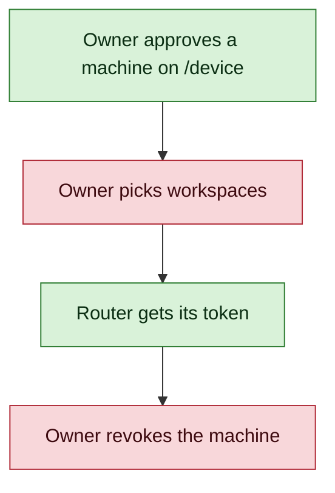

# Shared audit report format (required for every reviewer and auditor)

**Owner (15 Nov):** "i need it to have diagram and be understandable"; "tell all agents to have the same audit format".

**Output is an HTML page, not markdown** (owner: "i cant read md files, the reports need to be made html with presentation html").
- Load `sunstack-dev:presentation-html` (`~/.codex/plugins/cache/sunstack/sunstack-dev/3.3.5/skills/presentation-html/SKILL.md`) and follow it: a Demistify page (theme.css + runtime.js binding as that skill says), `ex-document`, `ex-callout` for §1, `ex-mermaid` for the §2 diagram, native tables for §3–§8, and `details` for long evidence.
- Write it to `report-<ID>.html` (e.g. `report-R3.html`) in this folder. Run the published checker once (`pnpm dlx https://demistify.getagentstudio.dev/v1/demistify-cli.tgz check <file>`) and fix every error.
- A markdown working copy is optional. The HTML page is the deliverable.

**One deliverable per section set** (owner, 15 Nov: "every deliverable is gonna have separate design, we gonna do step by step; every design needs a full audit section of what's there and what needs to be fully fixed"). If your area covers more than one deliverable (R1 = B1 and BG; R2 = B2 and B2-additions), repeat §1–§8 **separately for each deliverable**, each with its own diagram, so each can drop into that deliverable's own design page. In §3 and §7, for every partial, missing or defect row, add a column **"Fully fixed means" *(plain)***: the observable end state that would close it.

**ONE PAGE PER DELIVERABLE, made for the owner to understand** (owner, 15 Nov: "no diagrams or decision components, how am I supposed to understand?"; "I want every deliverable broken up").
- **One HTML file per deliverable:** `report-B1.html`, `report-BG.html`, `report-B2.html`, `report-B2-additions.html`, `report-B3.html`. Never two deliverables on one page.
- **Top of the page, in this order:**
  1. a plain-words callout;
  2. **diagram 1:** how the deliverable works, every step coloured delivered / partial / missing / defect;
  3. **diagram 2:** verification, each obligation linked to the proof level required versus the proof level actually run (e.g. "real browser required → HTTP helper run"), coloured by gap;
  4. **diagram 3:** acceptance, each PR linked to what it was accepted against (approved design versus the Lead's goal), and what that skipped.
- **Every item in "Open for the owner" is an `ex-choice` decision component** (see `presentation-html` `references/options-and-decisions.md`). Each one has:
  - a short explanation and a small diagram of the current state versus each option;
  - each option with its gain and cost;
  - your recommendation;
  - what waits if the owner defers.
- **"What needs fixing":** a short list in plain words at the top, each item with "fully fixed means".
- **The dense tables (§3–§7) go inside `<details>` disclosures** below the diagrams, so the first screen is diagrams and plain words.
- Run the published checker to 0 errors.

Every audit or review report uses **exactly** these sections, in this order, with these columns. The Lead builds the owner's register page directly from them, so keep every column. Write "none" or "unknown" rather than leaving a cell out.

**Plain-words rule:** every column marked *(plain)* is written for the owner. Say what a person or machine can or can't do, in a sentence. No code names, IDs or jargon in those cells; anchors go in their own columns.

**IDs:** prefix your area (R1, R2, R3, A1, C-…), e.g. `R3-O7` for an outcome, `R3-V7` for verification, `R3-D2` for a decision, `R3-X1` for a defect. A verification row uses the same number as the outcome it proves.

---

## 0. Header
- **Area, reviewer:** the area and deliverable(s); the reviewer's session id, model and effort.
- **Skills loaded:** list them, e.g. `role-checker`, `design-review`, `principle-verify-before-accepting`, `principle-prove-it-works`, `principle-write-tests-that-can-fail`.
- **Sources pinned:** design commit; each repo ref and commit read; evidence folders read.

## 1. In plain words (at most 6 lines)
What this deliverable is for. What a person or machine can do today, and what they can't. One overall verdict: **delivered / partly delivered / not delivered**.

## 2. Diagram: how it works, and what state each step is in
One Mermaid `flowchart` (top-down or left-right). Each node is a step a person or machine takes in the approved design. Colour each node by state, using exactly these classes:

````

````

**Every diagram must fit the screen without horizontal scrolling** (owner screenshot, 15 Nov: "why does the diagram not fit the screen?").
- Use `flowchart TB` (top to bottom), not `LR`, unless the diagram has at most 4 nodes in a row.
- Put `data-width="canvas"` on every `ex-mermaid`.
- Keep labels to at most 8 words; use `<br/>` for a second line.
- Split a diagram with more than about 12 nodes into two smaller ones.

**Every classDef must set `color:` (dark text), exactly as above.** The owner reads in dark mode, and without `color:` the text renders white on pale boxes and can't be read (owner screenshot, 15 Nov). Also apply the classes to every node, and keep labels short. Use `defect` for a step that's built but wrong. Keep each label to at most 8 words, and cover every outcome in §3.

## 3. Outcomes: what was approved, and what exists
| ID | Obligation *(plain)* | Design anchor (file § / line) | State: delivered / partial / missing / contradicted | Code anchor (repo@commit:path:line) | PR(s) |
|---|---|---|---|---|---|

## 4. Verification: required proof versus what was actually run
| ID (matches §3) | Required proof *(plain)*: what must be shown, at what boundary (real browser, real Router, real provider, staging, both hosts, production negative) | VD / proof-table anchor | Actually run *(plain)* | Run by: independent Verifier / author run audited by the Verifier / CI / none | Version (PR head + central commit) | Evidence path | Gap *(plain)* |
|---|---|---|---|---|---|---|---|

## 5. Acceptance: how each PR was accepted, and how it should have been
| PR | Accepted by, and when | Accepted against: approved design / Lead's WS goal / nothing recorded | What that acceptance skipped *(plain)* | Should have been checked against (design + VD anchors) | Verdict now: stands / partial / should not have been accepted |
|---|---|---|---|---|---|

## 6. Decisions: who decided, and whether it was theirs to decide
| ID | Decision *(plain)* | Whose: owner, first-hand (transcript path:line, time) / Lead's call / relayed and unconfirmed | Within that party's authority? | Effect on an approved outcome *(plain)* | Verdict: ok / should have been the owner's / wrong / superseded |
|---|---|---|---|---|---|

## 7. Defects
| ID | Severity P0–P3 | What goes wrong *(plain)* | Failure scenario (inputs → wrong result) | Anchor |
|---|---|---|---|---|

## 8. Open for the owner
| Question *(plain)* | Options, each with its gain and cost | Why only the owner can decide | What waits if deferred |
|---|---|---|---|

## 9. Could not check
Each item with the reason (access, time, out of scope).
